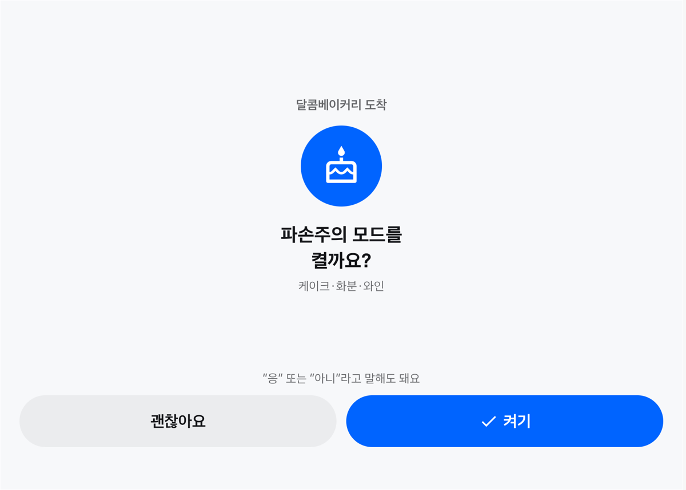
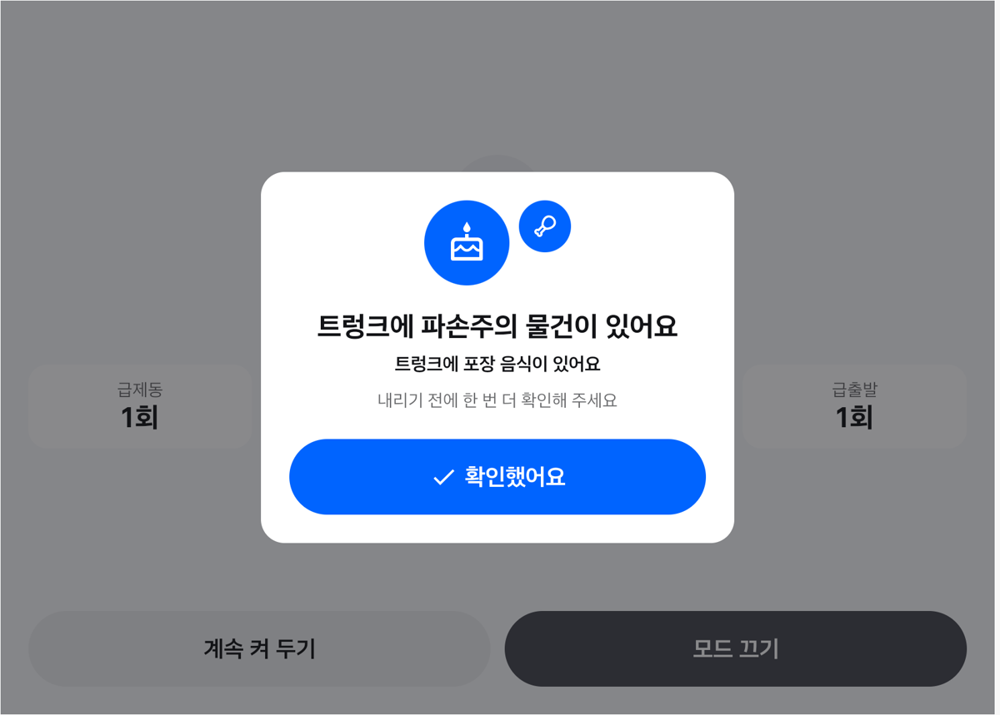
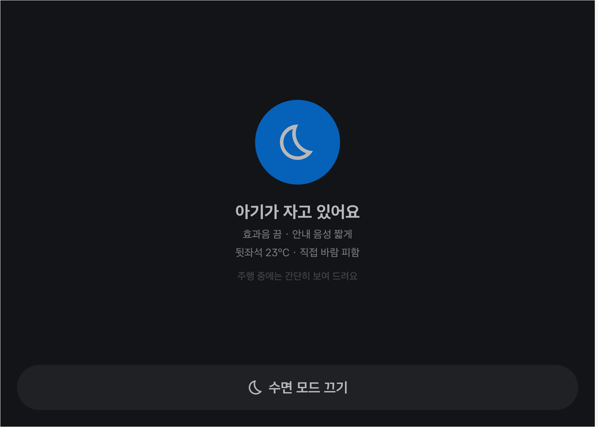

<div align="center">

<picture>
  <source media="(prefers-color-scheme: dark)" srcset="branding/goi-logo-dark.svg">
  
</picture>

# 고이

**무엇을 싣든 누구를 태우든, 고이 모셔다 드릴게요**

차 안 사정을 살펴 섬세한 운전을 돕는 Pleos Connect 앱

[](https://appdevchallenge.auto-hmg.io/)
[](https://document.pleos.ai/docs/pleos-only/connect-sdk-pleos/)
<br>
[](https://source.android.com/docs/automotive)


[**APK 받기**](apk/GOET_goi_release.apk) · [실행 방법](#실행-방법) · [테스트 환경](#테스트-환경) · [개발 문서](docs/development.md)


<sub>모의주행 중 빵집에 다가가자 뜬 파손주의 모드 제안</sub>

</div>

## 배경

| 이럴 때 | 고이는 |
|---|---|
| 치킨 냄새가 차에 밸까 봐 | 외기 유입·바람 세게, 모드를 끄면 원래대로 |
| 커피·케이크가 쏟아질까 봐 | 앞 커브는 미리 말로, 급제동·급출발은 효과음으로 |
| 트렁크 짐, 뒷좌석 아기를 깜빡할까 봐 | 운전석 문을 열 때 하차 알림 |
| 잠든 아기가 깰까 봐 | 효과음은 끄고 안내는 짧게 |

공조 제어도, 조향각·기어·트렁크 읽기도 휴대폰 앱으로는 불가능한 일

## 모드

| 모드 | 민감도 | 공조 | 도착하면 |
|---|---|---|---|
| **파손주의**<br><sub>케이크·화분·와인</sub> | 최고 | 온도 낮추기·바람 줄이기(선택) | 트렁크 확인 |
| **포장&nbsp;음식**<br><sub>치킨·피자·족발</sub> | 보통 | 냄새 빼기 | 트렁크 확인 |
| **음료**<br><sub>커피·버블티·국물</sub> | 높음 | — | 컵홀더 확인 |
| **반려동물**<br><sub>강아지·고양이</sub> | 높음 | 뒷좌석 온도 유지·주기적 환기 | 뒷좌석 확인 |
| **아기**<br><sub>뒷좌석 카시트</sub> | 높음 | 뒷좌석 온도 유지·직접 바람 피하기·주기적 환기 | 뒷좌석 확인 |

여러 모드를 함께 켜면 가장 민감한 기준과 모든 공조 항목을 합침. 반려동물은 휴식 안내, 아기는 "아기 자요" 한마디로 수면 모드

## 주행 장면

아이 생일 케이크를 찾고, 가는 길에 치킨까지 포장해 집에 가는 길

<table>
  <tr>
    <td width="50%"></td>
    <td width="50%"></td>
  </tr>
  <tr>
    <td><b>빵집 도착</b><br>파손주의 모드 제안, "응"으로 켜기</td>
    <td><b>주행 중</b><br>화면은 한 줄, 안내는 음성으로</td>
  </tr>
  <tr>
    <td></td>
    <td></td>
  </tr>
  <tr>
    <td><b>치킨 포장</b><br>포장 음식 모드 추가</td>
    <td><b>집 도착</b><br>운반 요약</td>
  </tr>
  <tr>
    <td></td>
    <td></td>
  </tr>
  <tr>
    <td><b>문 열 때</b><br>트렁크 속 케이크 알림</td>
    <td><b>아기 수면 모드</b><br>효과음 없이, 화면은 어둡게</td>
  </tr>
</table>

## Pleos SDK 활용

| SDK | 쓰는 곳 |
|---|---|
| Vehicle | 기어·조향각·문·트렁크 상태, 공조 제어 |
| NaviHelper | 경로 앞 급커브·유턴 미리 안내 |
| FusedLocation | 픽업 장소 도착 감지 |
| TextToSpeech · SpeechToText | 음성 안내, "응"·"아기 자요" 같은 대답 |
| AAOS Car API | 차속 |

## 실행 방법

1. Pleos Connect Emulator v2.1.0(API 34) 설치 후 Cold boot ([설치 가이드](https://document.pleos.ai/docs/connect/guide/getting-started/application-development/setup-connect-sdk-emulator))
2. APK 설치
   ```sh
   adb install -r apk/GOET_goi_release.apk
   ```
3. **고이** 실행, 차속·위치·마이크·알림 권한 허용
4. Virtual Console에서 기어·브레이크·조향각·문·공조 조작

소스 빌드는 `./gradlew assembleRelease`, 데모 주입이 들어간 개발용은 `./gradlew installDebug`

## 테스트 환경

| 항목 | 값 |
|---|---|
| 에뮬레이터 | Pleos Connect Emulator v2.1.0, Android 14(API 34), Connect-S 2560x1440 160dpi |
| 빌드 | Gradle 9.8, AGP 9.4.1, Kotlin 2.4.20, Jetpack Compose, JDK 17+ |
| SDK | Vehicle 2.3.2, NaviHelper 3.0.5, FusedLocation 1.1.3, TextToSpeech 3.3.1, SpeechToText 3.3.1 |
| minSdk / targetSdk | 28 / 34 |
| APK | [`apk/GOET_goi_release.apk`](apk/GOET_goi_release.apk) |

필요한 설정

- **공조**: Virtual Console에서 HVAC Power 켜기. 꺼져 있으면 공조 대신 음성으로 권유
- **커브 사전 안내**: 내비 경로 안내 중에만 동작
- **픽업 장소**: 처음 실행 때 기본 3곳 등록(달콤베이커리·바삭치킨 역삼점·카페 드라이브스루)

## 검증 현황

- 단위 테스트 20개 통과(`./gradlew testDebugUnitTest`)
- 모의주행(실제 차속·기어·GPS): 픽업 장소 제안, 음성 대답, 급제동 감지, 도착 요약, 하차 알림
- 앱 안 주입(`scripts/drive-sim.sh`): 커브 사전 안내, 모드 겹침, 트렁크 알림, 수면 모드, 휴식 안내
- 주행 중에도 주행 규제 화면 대신 고이 화면 유지(`distractionOptimized`)

제약과 대안, 데모·시뮬레이션 방법, 화면 설계는 [개발 문서](docs/development.md)에

---

<div align="center">
<sub>2026 현대자동차그룹 차량용 앱 개발 공모전 출품작 · 팀 GOET</sub>
</div>
