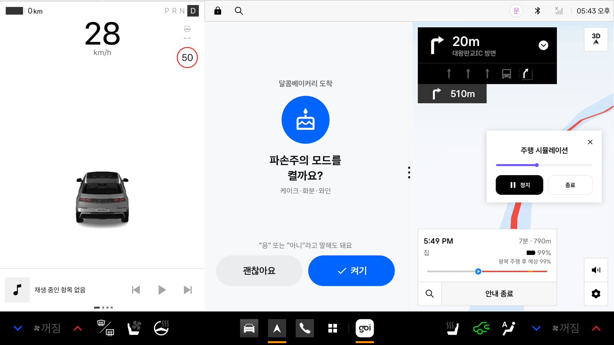
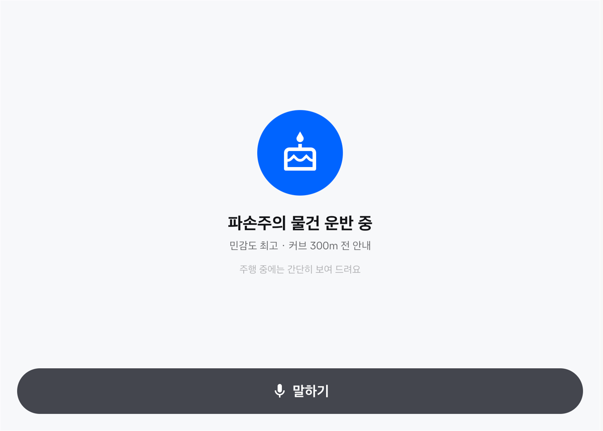
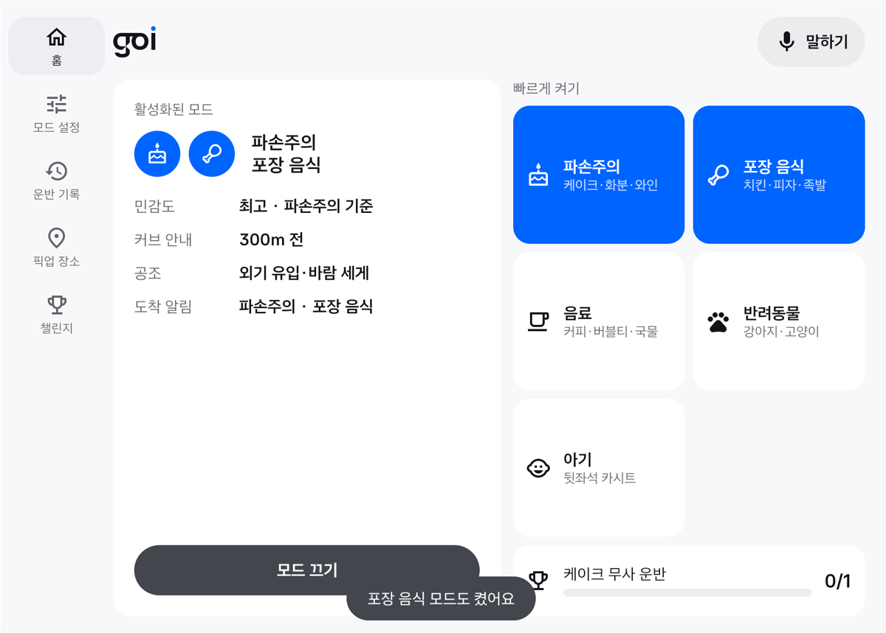
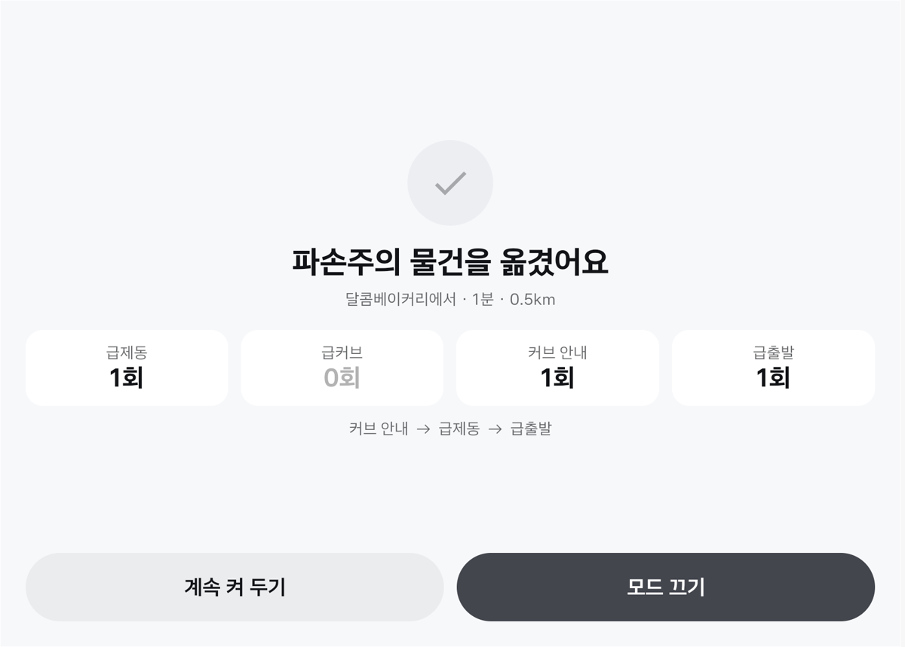

<div align="center">

<picture>
  <source media="(prefers-color-scheme: dark)" srcset="branding/goi-logo-dark.svg">
  
</picture>

# 고이

**무엇을 싣고 누구를 태웠는지 아는 차**

케이크·포장 음식·음료·반려동물·아기에 맞춰 주행 안내와 공조를 바꿔 주는 Pleos Connect 앱

[](https://appdevchallenge.auto-hmg.io/)
[](https://document.pleos.ai/docs/pleos-only/connect-sdk-pleos/)
<br>
[](https://source.android.com/docs/automotive)


[**APK 받기**](apk/GOET_goi_release.apk) · [실행 방법](#실행-방법) · [테스트 환경](#테스트-환경) · [동작 화면](#한-번의-주행으로-보기) · [검증 현황](#검증-현황)



<sub>모의주행 중 픽업 장소(빵집)에 다가가자 파손주의 모드를 제안하는 장면. 차속·기어·위치는 내비 경로 시뮬레이션을 따라 움직인 시스템 값이다</sub>

</div>

## 왜 필요한가

포장, 드라이브스루, 마트 픽업처럼 차에 무언가를 싣는 순간은 일상적이다. 하지만 차는 무엇을 실었는지 모르고, 냄새를 빼고·커브에서 조심하고·내릴 때 챙기는 일은 모두 운전자의 손과 기억에 맡겨져 있다.

| 지금 운전자가 겪는 일 | 고이가 바꾸는 것 |
|---|---|
| 치킨을 싣고 운전 중에 외기 전환·풍량을 직접 조작한다 | 모드를 켜면 외기 유입과 바람 세기를 한 번에 바꾸고, 끄면 원래대로 돌린다 |
| 커피·케이크를 싣고 "조심해서" 달리지만 언제 커브가 오는지 모른다 | 내비 경로 앞 급커브·유턴을 미리 말로 알리고, 급제동·급출발·급커브를 효과음으로 알린다 |
| 트렁크에 둔 포장 음식, 뒷좌석의 아기·반려동물을 깜빡한다 | 도착해 운전석 문을 열면 무엇이 어디에 있는지 알린다 |
| 잠든 아기가 급제동이나 큰 안내 음성에 깬다 | "아기 자요" 한마디로 효과음을 끄고 안내를 짧게, 화면을 어둡게 한다 |

휴대폰은 공조를 바꾸거나 조향각·기어·트렁크 상태를 읽을 수 없다. 고이의 기능은 모두 차량 데이터와 차량 제어 위에서만 동작한다.

## 모드

하나의 센서 엔진(`CareEngine`)에 모드별 값(민감도·커브 안내 거리·공조 항목·하차 문구)만 바꿔 끼운다. 모드는 함께 켤 수 있고, 겹치면 가장 민감한 기준과 모든 공조 항목을 합친다.

| 모드 | 민감도 · 커브 안내 | 공조(기본값) | 도착하면 |
|---|---|---|---|
| **파손주의**<br><sub>케이크·화분·와인</sub> | 최고 · 300m 전 | 실내 온도 낮추기·바람 줄이기(직접 켤 때만) | "트렁크에 파손주의 물건이 있어요" |
| **포장&nbsp;음식**<br><sub>치킨·피자·족발</sub> | 보통 · 200m 전 | 냄새 빼기(외기 유입 + 바람 2단계) | "트렁크에 포장 음식이 있어요" |
| **음료**<br><sub>커피·버블티·국물</sub> | 높음 · 200m 전 | 바꾸지 않음 | "컵홀더의 음료를 챙기세요" |
| **반려동물**<br><sub>강아지·고양이</sub> | 높음 · 200m 전 | 뒷좌석 온도 유지·주기적 환기(주행 중에만) | "뒷좌석에 반려동물이 있어요"(확인해야 닫힘), 1시간마다 휴식 안내 |
| **아기**<br><sub>뒷좌석 카시트</sub> | 높음 · 200m 전 | 뒷좌석 온도 유지·직접 바람 피하기·주기적 환기(주행 중에만) | "뒷좌석에 아기가 있어요"(확인해야 닫힘), 수면 모드 |

## 한 번의 주행으로 보기

기획서 페르소나 박준호 씨가 아이 생일 케이크를 찾고, 가는 길에 치킨까지 포장해 집에 가는 길이다(`scripts/drive-sim.sh cake`).

<table>
  <tr>
    <td width="50%"></td>
    <td width="50%"></td>
  </tr>
  <tr>
    <td><b>① 픽업 장소에 들어서면</b><br>"달콤베이커리에 왔어요. 파손주의 모드를 켤까요?" → "응"</td>
    <td><b>② 주행 중에는 한 줄과 소리로</b><br>"앞에 커브가 있어요, 천천히" · 급제동은 효과음 + "급제동이에요"</td>
  </tr>
  <tr>
    <td></td>
    <td></td>
  </tr>
  <tr>
    <td><b>③ 드라이브스루에서 모드 추가</b><br>민감도는 파손주의 기준을 지키고, 공조는 냄새 빼기를 더한다</td>
    <td><b>④ 기어 P로 도착하면</b><br>급제동·급커브·커브 안내·급출발 횟수와 순서를 요약한다</td>
  </tr>
  <tr>
    <td></td>
    <td></td>
  </tr>
  <tr>
    <td><b>⑤ 운전석 문을 열면</b><br>픽업 때 트렁크를 연 모드만 기억해 "트렁크에 파손주의 물건이 있어요"</td>
    <td><b>⑥ 아기 수면 모드</b><br>"아기 자요"로 켠다. 효과음을 끄고, 감지한 일은 신호 대기 때 보여 준다</td>
  </tr>
</table>

## 주요 기능

| 기능 | 동작 | 차량 데이터 · SDK |
|---|---|---|
| 픽업 장소 자동 제안 | 등록한 장소에 들어서면 맞는 모드를 음성으로 묻고 "응"으로 켠다 | FusedLocation 근접 알림, TTS, STT |
| 쏠림 감지 | 약 1초 차속 변화로 급제동·급출발, 조향각과 차속으로 급커브(a<sub>y</sub> ≈ v²·tan(δ/i)/L)를 모드 민감도 기준으로 판정한다. 한 번의 급제동은 한 번만 센다 | AAOS `PERF_VEHICLE_SPEED`, Vehicle SteeringWheel |
| 커브 사전 안내 | 내비 경로 앞 급커브(`TURN_SHARP_*`)·유턴이 설정한 거리(100·200·300m) 안에 들어오면 미리 말한다 | NaviHelper `onTBTInfo` |
| 모드별 공조 | 냄새 빼기, 실내 온도 낮추기, 바람 줄이기, 뒷좌석 온도 유지, 직접 바람 피하기, 주기적 환기(10·20·30분). 모드를 모두 끄면 원래 값으로 돌린다. 쓸 수 없으면 "외기로 바꿔 보세요"라는 음성 권유로 대신한다 | Vehicle HVAC(capability 확인 후 쓰기) |
| 운반 요약 | 기어 P로 도착하면 모드별 축하 문구 또는 도착 사실, 출발 장소·시간·거리, 감지한 일의 횟수와 순서를 보여 준다 | Vehicle Gear, 차속 적분 |
| 하차 알림 | 도착 후 운전석 문이 열리면 트렁크·뒷좌석·컵홀더를 알린다. 아기·반려동물은 확인 버튼을 눌러야 닫힌다 | Vehicle Door(`ROW_1_LEFT`, `REAR`) |
| 아기 수면 모드 | 효과음을 끄고 안내 음성을 짧게, 화면을 어둡게. 감지한 일은 신호 대기 때 "수면 중 알림"으로 보여 준다 | STT |
| 휴식 안내 | 반려동물 모드에서 정한 간격(1·2시간)마다 쉬어 가라고 말한다 | 주행 시간 |
| 챌린지 | 커피 한 방울도 안 흘리기, 케이크 무사 운반, 멀미 없는 드라이브, 국물 한 방울도 지키기, 깨우지 않고 도착. 운반 기록에서 계산한다 | 운반 기록 |
| 백그라운드 | 모드가 켜진 동안 포그라운드 서비스로 리스너를 유지하고, 화면 밖에서는 제안·알림을 시스템 알림으로 띄운다 | — |

<details>
<summary>Pleos Connect SDK와 퍼미션</summary>

| SDK / API | 버전 | 쓰는 곳 |
|---|---|---|
| Vehicle | 2.3.2 | 기어·조향각(쏠림 판정·도착), 운전석 문·트렁크(하차 알림), HVAC 읽기·쓰기 |
| NaviHelper | 3.0.5 | TBT 급커브·유턴 사전 안내 |
| FusedLocation | 1.1.3 | 픽업 장소 근접 알림 |
| TextToSpeech | 3.3.1 | 모든 안내 음성(온디바이스 ko-KR) |
| SpeechToText | 3.3.1 | "응", "케이크 옮길래", "아기 자요" 같은 음성 명령(온디바이스 ko-KR) |
| AAOS Car API | — | 차속 `PERF_VEHICLE_SPEED` |

Vehicle SDK 쓰기는 `check*Capabilities`로 WRITE를 확인한 영역에만 하고, 매니페스트에는 실제로 쓰는 퍼미션만 선언한다(`app/src/main/AndroidManifest.xml`). `MainActivity`는 `distractionOptimized`를 선언해 주행 규제 중에도 화면이 보인다.

</details>

## 실행 방법

### APK로 실행

1. Android Studio에 Pleos Connect Emulator v2.1.0(API 34)을 설치하고 AVD를 Cold boot로 실행한다.
   ([설치 가이드](https://document.pleos.ai/docs/connect/guide/getting-started/application-development/setup-connect-sdk-emulator))
2. 제출용 release APK를 설치한다.
   ```sh
   adb install -r apk/GOET_goi_release.apk
   ```
3. 앱 목록에서 **고이**를 실행하고 차속·위치·마이크·알림 권한을 허용한다.
4. 차량 상태는 Pleos Connect Virtual Console(Gear Selection, Brake Pedal, Steering Angle, Door/Trunk, Climate)로 바꾼다.

### 소스에서 빌드

```sh
./gradlew installDebug          # 개발용(데모 주입 포함)
./gradlew assembleRelease       # 제출용 → app/build/outputs/apk/release/app-release.apk
./gradlew testDebugUnitTest     # 단위 테스트
```

Pleos Connect SDK는 `settings.gradle.kts`에 등록한 Pleos Maven 저장소(`nexus-playground.pleos.ai`)에서 받는다.

## 테스트 환경

| 항목 | 값 |
|---|---|
| 에뮬레이터 | Pleos Connect Emulator v2.1.0, Android 14(API 34), Connect-S 2560x1440 160dpi |
| 빌드 | Gradle 9.8, AGP 9.4.1, Kotlin 2.4.20, Jetpack Compose, JDK 17+ |
| SDK | Vehicle 2.3.2, NaviHelper 3.0.5, FusedLocation 1.1.3, TextToSpeech 3.3.1, SpeechToText 3.3.1 |
| minSdk / targetSdk | 28 / 34 |
| APK | [`apk/GOET_goi_release.apk`](apk/GOET_goi_release.apk) (release, 지금은 debug 키로 서명) |

필요한 설정:

- **권한**: 처음 실행할 때 차속·위치·마이크·알림 권한을 허용한다.
- **공조**: 에뮬레이터 공조 전원이 꺼져 있으면 HVAC 쓰기가 `PropertyNotAvailable`로 실패하고 음성 권유로 대신한다. Virtual Console에서 HVAC Power를 켜면 적용된다.
- **커브 사전 안내**: 내비에 경로 안내가 켜져 있어야 TBT가 들어온다.
- **픽업 장소**: 처음 실행하면 기본 장소 3곳(달콤베이커리·바삭치킨 역삼점·카페 드라이브스루)이 등록된다. 픽업 장소 화면에서 "지금 위치를 픽업 장소로 저장"으로 더 등록한다.

## 데모와 시뮬레이션

에뮬레이터에서 시나리오를 반복 재현하는 도구가 세 단계로 있다. 디버그 빌드에서만 쓴다.

| 도구 | 하는 일 | 결과 |
|---|---|---|
| 데모 주입(`DemoReceiver`) | adb 브로드캐스트로 차량 상태·장소 진입·발화를 앱 안에서만 바꿔 넣는다 | 즉시 |
| `scripts/drive-sim.sh` | 페르소나 시나리오를 앱 안 주입값으로 빠르게 재현한다(0.25초 간격으로 차속을 조금씩 바꿈) | `build/sim/<시나리오>/` 단계별 화면, `log.txt` |
| `scripts/road-test.sh` | 내비 경로 시뮬레이션이 차를 움직이고, 그 진행에 맞춰 시스템 차속·조향·기어(VHAL)와 GPS를 바꾸고, 대답은 마이크로 넣는다 | `build/road-test/<시나리오>/` 녹화·화면·확인 결과 |

<details>
<summary>데모 주입 명령</summary>

값에 공백을 넣지 않는다. 시스템 차속·주행 규제는 바뀌지 않는다.

```sh
B="adb shell am broadcast -a dev.seungmin.goi.DEMO -p dev.seungmin.goi"
$B --es enter seed-bakery            # 달콤베이커리 진입 → 파손주의 모드 제안
$B --es say 응                       # 음성 응답 대신
$B --ez trunk true; $B --ez trunk false   # 픽업 때 트렁크 열고 닫기
$B --es gear D --ef speed 20          # 출발(차속 km/h)
$B --ef speed 50 --es curve SHARP_R:250  # 앞 250m 급커브 → 사전 안내
$B --ef speed 15                      # 1초 안에 50→15: 급제동
$B --ef speed 0; $B --es gear P       # 도착 → 운반 요약
$B --ez door true                     # 운전석 문 열림 → 하차 알림
$B --es say 아기자요                  # 수면 모드
$B --ei elapse 61                     # 주행 시간 61분 앞당김 → 반려동물 휴식 안내
$B --ez reset true                    # 주입값 해제
$B --es route "37.3947,127.1112,판교역" --es via "37.40403,127.10425,카페"   # 내비 경로 요청(경유지 선택)
$B --ez navtrace true                 # 내비 위치·TBT를 GoiNavTrace 로그로(모의주행 GPS 미러용)
$B --es place "seed-bakery,달콤베이커리,37.41146,127.09936,50,FRAGILE"     # 픽업 장소를 좌표로 등록
```

</details>

<details>
<summary>시나리오 반복 시뮬레이션 (<code>drive-sim.sh</code>)</summary>

```sh
scripts/drive-sim.sh -c all        # -c: 앱 데이터를 지우고 기본 픽업 장소로 시작
scripts/drive-sim.sh baby          # 하나만
```

| 시나리오 | 흐름 |
|---|---|
| `cake` | 달콤베이커리 제안 → 트렁크 → 커브 사전 안내 → 급제동 → 치킨 드라이브스루에서 포장 음식 추가(겹침) → 도착 요약 → 하차 알림 |
| `baby` | 아기 모드 → "아기 자요" → 급제동(효과음 없이 기록) → 신호 대기에서 "수면 중 알림" → 출발하면 닫힘 → 도착 → 확인해야 닫히는 하차 확인 |
| `pet` | 반려동물 모드 → 급커브 → 61분 경과 휴식 안내 → 도착 |
| `coffee` | 드라이브스루 진입 중 음료 모드 제안 → 신호 출발 급출발 → 도착 → 컵홀더 알림 |

</details>

<details>
<summary>모의주행 (<code>road-test.sh</code>)</summary>

환경 구성 절차와 도구는 `.agents/skills/pleos-drive-sim/`(SKILL.md, scripts/)에 있다.

```sh
adb -s emulator-5554 emu grpc 8554     # 부팅마다 한 번(마이크 주입·소리 녹음)
scripts/road-test.sh all               # cake coffee baby pet food, 결과는 build/road-test/<시나리오>/
scripts/road-test.sh -n baby           # 녹화 없이 하나만
```

| 시나리오 | 흐름(실제 신호) |
|---|---|
| `cake` | 경유지 빵집에 다가가면 FusedLocation 근접 알림으로 제안 → "응"(STT) → 정차·P·트렁크 → 출발 → 급제동 → 창업로 유턴 사전 안내 → 도착 요약 → 하차 알림 |
| `coffee` | 판교역 가는 길 드라이브스루를 지나며 제안 → "응 켜줘" → 신호 대기 후 급출발 → 도착 → 컵홀더 알림 |
| `baby` | "아기 태웠어" → 출발 → 신호 대기에서 "아기 자요" 시도 → 수면 중 급제동(음성 없이 기록) → 유턴 안내 → 도착 → 확인해야 닫히는 하차 확인 |
| `pet` | "강아지 태웠어" → 빠르게(brisk) 회전하며 급커브 → 61분 경과 휴식 안내 → 도착 |
| `food` | "치킨 실었어" → 차분하게(calm) 끝까지 → 흔들림 오탐 0회, 무사 운반 요약 |

</details>

## 화면 설계

와이어프레임 v0.1의 화면 구성(G1–G6, F1–F7, A1–A3)을 따르고, 차량 화면이라 다음 원칙을 함께 지킨다.

- **주행 중엔 소리로, 멈추면 화면으로.** 주행 중 화면에는 켜진 모드, 상태 한 줄, 큰 버튼 하나만 둔다. 경고는 화면을 바꾸지 않고 TTS·효과음으로만 한다.
- **강조색은 하나.** Pleos Grayscale 토큰 위에 `informative_positive`(#0064FF, 다크 #0082FF) 하나만 켜진 모드와 주 동작에 쓴다. 모드별 색은 쓰지 않는다.
- **큰 표적.** 타일·행 112dp 이상, 버튼 96/128dp, 슬라이더 대신 Tabs. 픽업 장소는 검색·지도 대신 "지금 위치를 픽업 장소로 저장" 후 짐 종류만 고른다.
- **Pleos 차량 설정 톤.** 스위치에는 늘 설명(`~합니다`)을 붙이고, 음성·팝업·안내는 `~해요` 체로 쓴다.

| 상태 | Grid(세로 창) | Full(가로 창) |
|---|---|---|
| 주행 중 | G1 켜진 모드 + 상태 한 줄 + 말하기 / G5 수면 | F5 같은 화면 + 안내 한 줄 |
| 정차 중 | G3 모드 선택(모드 5개 + 말하기) → G4 활성화된 모드 | 좌측 레일: F1 홈 · F2/F7 모드 설정 · 운반 기록 · F4 픽업 장소 · F6 챌린지 |
| 이벤트 | G2 모드 제안, F3 운반 요약, A1 하차 알림(popup), G6 수면 중 이벤트 | 같은 화면 |

## 프로젝트 구조

```
app/src/main/java/dev/seungmin/goi/
├── care/    모드·공조 항목 정의, 공통 센서 엔진, 쏠림 판정, 챌린지, 음성 명령 파서
├── car/     Pleos SDK 연동(Vehicle·HVAC, NaviHelper TBT, FusedLocation 근접 알림)
├── voice/   TextToSpeech·SpeechToText(온디바이스, ko-KR)
├── data/    모드 설정·픽업 장소·운반 기록 저장
└── ui/      Compose 화면과 테마 토큰
app/src/debug/   에뮬레이터 데모용 adb 브로드캐스트 주입기(release에는 들어가지 않는다)
branding/        워드마크 SVG와 생성기
scripts/         drive-sim.sh, road-test.sh
apk/             제출용 release APK
```

## 검증 현황

**에뮬레이터·모의주행에서 확인한 것**

- Vehicle SDK로 기어·브레이크·조향각·운전석 문·트렁크 수신, AAOS 차속 수신, 공조 capability 조회
- 온디바이스 TTS(ko-KR) 발화, 마이크로 넣은 "응"·"아기 태웠어" STT 인식
- 모의주행(실제 차속·기어·GPS 신호): 픽업 장소 근접 제안, 음성 응답으로 모드 켜기, 급제동 감지와 음성 안내, 도착 요약, 운전석 문을 열 때 하차 알림(아기는 확인해야 닫힘)
- 앱 안 주입(`drive-sim.sh`): 커브 사전 안내, 모드 겹침, 트렁크 하차 알림, 수면 모드, 휴식 안내까지 네 시나리오 전체 흐름
- `distractionOptimized` 선언으로 차가 P를 벗어나도 주행 규제 화면 대신 고이 화면이 보인다(에뮬레이터 `user` 빌드, adb 설치본). 달릴 때는 주행 중 화면(G1·G5·G6), 신호 대기(D, 0 km/h)에는 정차 화면이 나온다
- 단위 테스트 20개(쏠림 판정, 음성 명령, 모드 합치기, 하차 문구, 챌린지, 운반 요약 제목)

**제약과 대안**

- Light SDK에는 앰비언트 색 제어 API가 없어(실내등 on/off만 제공) 기획서의 앰비언트 색상 기능은 넣지 않았다.
- TTS SDK에 음량 API가 없어 수면 모드의 "안내 음성 작게"는 짧은 문장으로 대신한다.
- 뒷좌석 별도 온도 영역이 없는 차에서는 운전석 영역 온도를 맞춘다.
- 운반 요약의 도착지 이름은 내비 목적지를 읽지 않아 표시하지 않는다. 출발 장소는 픽업 장소 제안으로 모드를 켰을 때만 보인다.
- 주행 규제는 신호 대기도 DO 대상(`idling`, 설정 화면 제한 `NO_SETUP`)으로 본다. 공모전 시연을 위해 신호 대기에는 정차 화면을 그대로 두었으며, 출시하려면 이때도 주행 중 화면을 띄워야 한다.
- 에뮬레이터 마이크로 넣은 "아기 자요"는 다른 말로 인식될 때가 많다(5번 중 1번 인식). `scripts/road-test.sh`는 못 알아들으면 디버그 주입으로 이어 간다.
- 챌린지는 운반 기록으로 계산하며, 외부 공유·인증 배지는 넣지 않았다.

---

<div align="center">
<sub>2026 현대자동차그룹 차량용 앱 개발 공모전 출품작 · 팀 GOET</sub>
</div>
